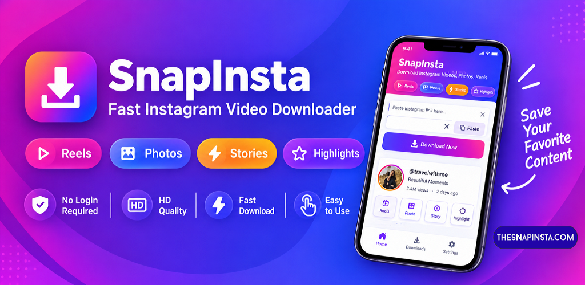

# 📸 SnapInsta — Instagram Reels, Story & Video Downloader (Android & Web)

  

  
  
  
  

---

## 🌐 Official Web Portal & Free Online Tools

Access our high-speed media downloader on any device (PC, Mac, iPhone, Android):

* 🚀 **Official Web Portal:** [https://thesnapinsta.com/en](https://thesnapinsta.com/en)
* 🎞️ **Instagram Reels Downloader:** [https://thesnapinsta.com/en/instagram-reels-downloader](https://thesnapinsta.com/en/instagram-reels-downloader)
* 📖 **Instagram Story Downloader:** [https://thesnapinsta.com/en/instagram-stories-downloader](https://thesnapinsta.com/en/instagram-stories-downloader)
* 📸 **Instagram Photo & Carousel Saver:** [https://thesnapinsta.com/en/instagram-photo-downloader](https://thesnapinsta.com/en/instagram-photo-downloader)
* 🕵️ **Anonymous Instagram Viewer (AnonyIG):** [https://thesnapinsta.com/en/anonyig](https://thesnapinsta.com/en/anonyig)

---

## 📱 About SnapInsta Android App

**SnapInsta** is an ultra-fast, lightweight, and secure Android utility application designed to download and archive public Instagram content in original Full HD resolution (1080p / 4K) without watermarks, subscriptions, or login credentials.

* **App Package:** `com.thesnapinsta.app`
* **Version:** `1.0.0`
* **File Size:** `2.39 MB` (Ultra Lightweight)
* **Target OS:** Android 7.0 (API 24) or higher
* **Official Website:** [https://thesnapinsta.com/en](https://thesnapinsta.com/en)

---

## 🚀 Key Features

* ⚡ **Full HD Video & Reels Downloads:** Save public Instagram Reels and high-bitrate MP4 videos at original quality without watermarks via [TheSnapInsta](https://thesnapinsta.com/en/instagram-reels-downloader).
* 🕒 **Story & Highlights Archiver:** Download 24-hour stories and full story highlight albums before they disappear using our [Instagram Story Saver](https://thesnapinsta.com/en/instagram-stories-downloader).
* 🖼️ **Ultra HD Photo & Carousel Saver:** Download single photos, multi-slide albums, and carousel posts in full crisp resolution.
* 🎵 **Direct Audio (MP3) Extraction:** Extract background audio and music tracks directly from Instagram videos.
* 👤 **Public DP Zoom & Viewer:** Enlarge public Instagram profile pictures in high resolution.
* 🔒 **100% Privacy & No Login:** No Instagram account required; completely anonymous and secure.

---

## 📥 How to Use

1. Copy the URL of any public Instagram Reel, Story, or Post.
2. Open the **SnapInsta App** or visit [TheSnapInsta Web Tool](https://thesnapinsta.com/en).
3. Paste the copied link into the input box and tap **Download**.
4. Save the original clean MP4 or JPG file directly to your device storage.

---

## 📄 License & Disclaimer

This project is licensed under the MIT License. SnapInsta is an independent utility and is not affiliated, endorsed, or associated with Instagram or Meta.
